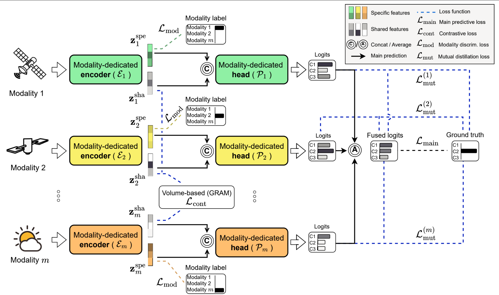
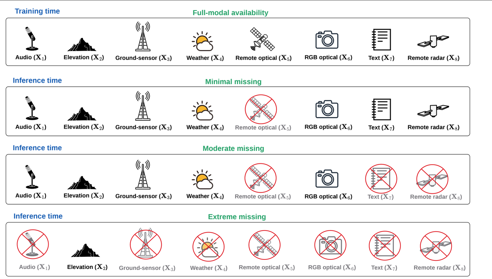

# CoMiss & FullCo: Multi-modal Co-Learning for Handling Missing Modalities
[](https://www.arxiv.org/abs/2607.24683) 

> Public repository of our work [*Co-Learning for Missing Arbitrary Modalities in Multi-modal Classification*](https://www.arxiv.org/abs/2607.24683) 

---



The previous image illustrates our **FullCo** framework in a multi-modal co-learning setting. The objective is to leverage multi-modal co-learning for increasing the robustness of the model to missing modalities at inference time.


## Training
We provide config file examples on how to train our model with different settings.

* To train the FullCo method in the Multi-CropHarvest dataset, run:  
```
python train.py -s config/ours/fullco_crop.yaml
```
* To train the CoMiss method (with a single random missing modality case) in the Multi-CropHarvest dataset, run:  
```
python train.py -s config/ours/comissv2_crop.yaml
```
* To train the CoMiss method (default: all missing modality combinaons) in the Multi-CropHarvest dataset, run:  
```
python train.py -s config/ours/comiss_crop.yaml
```
For other datasets you can check the other config files in the  [config folder](./config).


## Evaluation


* To evaluate the predictive performance run:
```
python evaluate.py -s config/eval.yaml
```
All details to folder paths and configurations are inside the yaml files.


---

